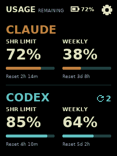
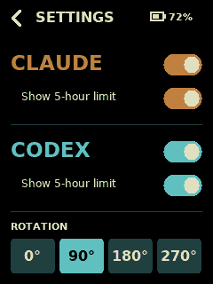

# Token Usage Meter for CYD

A 240×320 portrait quota display for a 2.8-inch CYD. Shows **remaining** 5-hour and weekly allowances for Claude and Codex, with reset countdowns. Built from the [original Codex meter](https://github.com/drofnas/codex-meter)'s collector, private LAN API, calibrated display/touch setup, and battery diagnostics.

| Usage | On-device settings |
| --- | --- |
|  |  |

These are native firmware renderer captures using synthetic readings at the target resolution. The approved design references are in [output/imagegen](output/imagegen/).

- Tap the gear to enable/disable either provider, show/hide its 5-hour limit, or rotate the display.
- Changes save immediately in device flash and survive reboot. No save button is needed.
- The default is portrait, with both providers and their available windows visible. Rotation labels follow the original app: **90° and 270° are portrait**, 0° and 180° are landscape.
- Available subscription resets appear as a reload icon and number, right-aligned beside the provider title. Zero, unsupported, unknown, and stale counts stay hidden. Codex supplies this count; Claude currently does not.
- Missing 5-hour windows hide automatically; weekly usage expands into that space. There is no hard-coded subscription tier list.
- Quota percentages use a consistent font size within each orientation, including `100%` and `>99%`. Portrait values fit above the 100-pixel bars without shrinking individual readings.
- Disabling a provider hides it on this device; it does **not** stop the host collector polling. Hidden providers retain their 5-hour preference. Settings remain reachable with both providers off.
- A failed or stale refresh keeps the last reading with a warning. An expired window says “Reset pending”; the display never invents a refill.

This displays subscription quota percentages, not billable token counts. Claude's weekly value is its overall `seven_day` window; model-specific weekly windows and extra-usage spending are outside this first version.

## Host setup (macOS)

Requires Python 3.11+, Go 1.27.2 or newer, Docker Desktop with Compose, and existing subscription sign-ins in Codex and Claude Code. The device must share a trusted LAN with the Mac.

Clone the development branch first:

```sh
git clone --branch dev https://github.com/drofnas/token-usage-meter.git
cd token-usage-meter
```

```sh
python3 scripts/meter.py addresses
python3 scripts/meter.py configure --bind-address YOUR_MAC_LAN_IP
python3 scripts/meter.py install
python3 scripts/meter.py start
python3 scripts/meter.py status
```

`configure` creates a private `.local/meter/.env` with a new dedicated meter token. Replace `YOUR_MAC_LAN_IP` with a literal IPv4 address from your LAN; reserve that address in your router. The new app uses port **8081**, separate launchd labels, a separate Compose project, and separate storage from the original meter.

`install` builds the native collector and Docker API, and registers stopped login services. `start` enables them now and at login. The Mac must stay awake and Docker Desktop must be running. `stop` disables both; `uninstall` removes owned jobs and the collector binary while preserving configuration and cached data.

Credential sources:

| Provider | Default source | Override at configure time |
| --- | --- | --- |
| Codex | `~/.codex/auth.json` from a ChatGPT sign-in | `--auth-file PATH` |
| Claude | macOS Keychain service `Claude Code-credentials`; fallback `~/.claude/.credentials.json` | `--claude-auth-file PATH` |

The collector only reads credentials. Sign-in and token refresh remain owned by Codex and Claude Code; reopen/sign in to the relevant app if a credential expires. macOS may request Keychain access on first use. API-key-only accounts and custom Claude credential stores require a compatible subscription credential file; raw API keys do not supply these quotas.

The host polls each provider every five minutes. Failures back off independently to a maximum of 30 minutes; a rate-limit response waits at least five minutes. The default stale threshold is 15 minutes. Literal settings live in `.local/meter/.env`; do not source this file in a shell. After editing, stop and start the installation. The base app's `METER_TIMEZONE` setting is accepted, but the UI uses relative countdowns.

## Device setup

The configuration targets the original project's ESP32-2432S028/E32R28T wiring: 4 MB flash, no PSRAM, calibrated XPT2046 touch, and a quarter-screen 8-bit display buffer. Other CYD variants may need pin, panel, or touch calibration changes.

```sh
python3 -m venv .venv
.venv/bin/python -m pip install -r requirements.txt
cp secrets.example.yaml secrets.yaml
```

Edit ignored `secrets.yaml` with the Wi-Fi name/password, `http://YOUR_MAC_LAN_IP:8081/v3/usage`, and the dedicated `METER_API_TOKEN` from `.local/meter/.env`. Keep the YAML values quoted. Leave the default 60-second device poll and 10-second timeout initially.

```sh
python3 scripts/firmware.py validate
python3 scripts/firmware.py build
python3 scripts/firmware.py flash --port YOUR_USB_SERIAL_PORT
python3 scripts/firmware.py verify --port YOUR_USB_SERIAL_PORT
python3 scripts/firmware.py logs --port YOUR_USB_SERIAL_PORT
```

The helper can also use an installed ESPHome Device Builder Python runtime, or `ESPHOME_PYTHON`. Select the serial port explicitly. Flashing uses the offsets from ESP-IDF's build manifest; it does not erase NVS settings. Each written region is verified during flashing. The later `verify` command checks the application, bootloader and partition table; OTA boot state can legitimately change after startup. Configuration and firmware binaries contain local secrets and must remain private.

Battery readings retain the base board's GPIO34 2:1 divider calibration. Set `battery_installed: false` in `cyd-meter-1.yaml` when running without a battery; the display then says USB. The board cannot reliably detect an empty connector or charging state. BOOT still dumps recent battery diagnostics to serial.

## Troubleshooting and boundaries

- **Sign in on your Mac:** refresh the corresponding native app's sign-in. `scripts/meter.py status` reports each collector error without printing credentials. Restarting the host services also resets retry backoff.
- **Last known / amber bars:** the provider, host, or Wi-Fi has not supplied a current reading. Check host status, LAN address, Docker, and the device serial log.
- **Settings not saved:** the current selection works in RAM, but the flash write failed. Retry the setting and inspect the device log before relying on it after power loss.
- **No limits available:** the provider returned no supported quota windows. Nothing is inferred from the plan's name.

The API accepts only the separate meter bearer token; provider credentials never go into Docker or firmware. The device connection is HTTP on a trusted LAN, so keep port 8081 private and do not expose it to the internet. Provider usage endpoints and credential formats can change; the collector fails visibly and preserves stale readings rather than guessing.

See [development checks](CONTRIBUTING.md), [the v3 contract](contracts/v3/README.md), and [validation evidence](docs/validation.md).

## License

[MIT](LICENSE), matching the original `codex-usage-meter` project and retaining its copyright notice. The embedded DejaVu font glyphs retain their [separate font license](assets/fonts/LICENSE).
